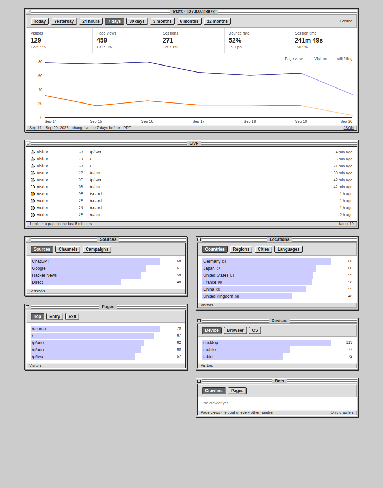

# exe-stats

Server-side analytics for a Go web server's public pages, in one
import: which pages a browser opened, where the visitor came from, from
what country and on what device — counted as the page is served, with no
script and no cookie, and read back as a Mac OS 9 Platinum desk.



It was the [exe hub](https://github.com/livid/exe-hub)'s own analytics
and now stands on its own, so the hub and [exe](https://github.com/livid/exe)
draw the same desk over their own readers.

## Use it

```go
db, _ := sql.Open("sqlite", "app.db?_pragma=journal_mode(WAL)&_pragma=busy_timeout(5000)")
db.SetMaxOpenConns(1)                        // SQLite takes one writer
st, err := stats.New(db, stats.Options{Location: time.Local})
go st.Run()

mux.HandleFunc("GET /{$}", st.Counted("home", home))   // a page that counts
mux.Handle("GET /stats", st.PageHandler())             // the desk
mux.Handle("GET /v1/stats", st.JSONHandler())          // the same report as JSON
```

`Handler` mounts the two at the paths the desk's own links use, `/stats`
and `/v1/stats`; mounted anywhere else its links would still point
there. `Counted` records a hit once the handler has answered 200, and only for
a request that was a person opening a page — a `fetch()`, a prefetch, a
404 and the page's own refetches are left out, and a crawler is kept
apart from every human number, under its name.

The host owns the database. This package opens no file and registers no
driver: it is handed a `*sql.DB`, keeps two tables in it (`hits` and
`hits_salt`) and leaves the rest alone, so a server can keep its readers
beside its own records.

The SQL is SQLite's. Hand it a pool the way the snippet does — WAL, a
busy timeout, and one connection — or a busy moment answers
`SQLITE_BUSY` and that second's hits are dropped rather than a request
delayed. A `:memory:` database needs the single connection even more:
with a pool, another connection is another empty database.

## What the desk shows

Visitors, page views, sessions, bounce rate and session time, each
against the span before; a chart of page views and visitors; who is
reading right now; and ranked lists of sources, channels and campaigns,
pages by top, entry and exit, countries, regions, cities and languages,
devices, browsers and systems, and the crawlers with the pages they
crawl. Every state is a URL — the range, a filter, each window's view —
so the page works without script and a view can be shared as a link.
With script the range last pressed is remembered in that browser, and a
view is fetched in place.

## Options

| field | what it does |
|---|---|
| `Location` | where the days begin: the salt rotates at midnight there and the buckets follow it (default UTC) |
| `PathLabel` | names a path in the lists — a hub names a thread by its words, a shop names a product (default: the path) |
| `Title` | the standalone page's window name (default "Stats") |
| `Log` | takes the collector's complaints and unreadable reports (default `log.Printf`) |
| `LiveHeader` | the header a page's own refetch carries, so it is not counted again (default `X-Hub-Live`) |
| `AnyClientKinds` | kinds of page counted whatever the client is, for a page tools read as much as browsers (the hub's agent guide) |
| `HomeURL`, `HomeLabel` | where the desk's close box leads (default `/`, "Home") |

`Stop` ends the writer, having written the hits it still held: call it
before closing the database.

## In your own chrome

A host whose pages have a look of their own renders the desk inside it
instead of taking the standalone page: parse `TemplateHTML()` into its
template set with `Funcs()`, put `statshead` in the document head with
`statscss`, and give the `stats` block what `PageData(r)` returns. That
is how the hub does it.

The blocks are named `statshead`, `statscss`, `stats` and `statsdisc`,
and the stylesheet's selectors all sit under `.sdesk`, so nothing of the
desk reaches the rest of a host's page. What the desk needs from the
host's own chrome is the Platinum window: `.window`, `.titlebar`,
`.tbox`, `.stripe`, `.title`, `.frame`, `.statusbar` and `.btn` — the
standalone page's `statsbase` block is a copy to start from.

## Privacy

A visitor is the day's hash of a secret salt, the address and the
browser. The salt is random, kept for the day so a restart keeps the day
whole, and then deleted — so yesterday's ids can never be recomputed and
no id can be turned back into a person. The address and the user agent
themselves are never stored: what a row holds is a country, a device, a
browser, a page and a time. There is no cookie, and nothing is sent to
anyone else.

Country, region and city come from the proxy's headers when there is one
(`CF-IPCountry`, `CF-Region`, `CF-IPCity`); without them those lists read
"Not known". An hour is counted where its middle falls, so in a zone offset by half
an hour the chart's first bucket may take an hour that began just before
it; the totals are exact either way. `Sweep` drops hits older than a time — a retention policy is
the host's to run, and there is none by default.

## The server

`cmd/exe-stats` is the package as a service for other people's sites,
the way plausible.io is one: sign in with a Solana wallet, add a site,
paste one script tag, and read that site on a desk of its own.

```sh
go build -o exe-stats ./cmd/exe-stats
./exe-stats -config config.json     # cmd/exe-stats/config.example.json
```

Every field of the config has a default, so no config at all runs a
server on `127.0.0.1:7795` over `./data`. It keeps `app.db` (accounts,
sessions, sites, the month's counts) and `sites/<id>.db`, one SQLite
file a site — each is the database this package is handed, so a site's
numbers can be copied or deleted as one file. `origin` is the public
address: the snippet names it, the sign-in message names its host, the
cookie is `Secure` when it is https, and a request that changes
something must come from it. `rpc_url` may carry an API key and is never
logged or shown.

**The snippet** is one line in a page's head:

```html
<script defer data-site="0123456789ab" src="https://stats.example.com/js/s.js"></script>
```

The script sends one beacon a page view — the page's address and where
the reader came from — and again when a page changes its own address
(`pushState`); a hash change is not a view. It sets no cookie and stores
nothing. The collect address, `POST /e`, counts a beacon only for a page
on one of the site's hosts — its domain, and any more its settings list
— sent from that page's own origin, and answers the same 202 whatever
became of it; the `X-Exe-Stats` response header says what did
(`counted`, `not this site's page`, `month full`, …), for an owner
checking a snippet in the browser's network panel.

**A site's settings** (`/sites/{id}/settings`, its Settings… button)
open under a toolbar with a trail, Sites › the site › Settings, the one
the exe documentation has, and begin with the setup check: a check mark that turns green once the
snippet reports a view from the site's own pages — counted or not, since
a resting site's snippet is in place too. Until then its line says the
page waits, or why a view was refused (a page on another host, or a
beacon sent from another origin), and the page asks
`/v1/sites/{id}/setup` again every few seconds, so a page of the site
opened in another tab turns it green. When the snippet last reported is
kept in `app.db`, to the minute; a refusal only in memory. A site that
counted before the check is read once from its own hits. Under it the
site's **hosts**: besides its domain, the names whose pages count too —
`blog.example.com`, `example.github.io`, or `*.example.com` for that
name and every name under it, twenty at most; each also counts its
`www.` name, as the domain does. A view from another of the site's hosts
is listed on the desk by host and path (`blog.example.com/post`), so its
front page is not the domain's, and a link from one of the site's hosts
to another is no source.

**Signing in** offers each detected wallet by name and icon when more
than one is installed, as the hub does. It is one signature over a message
the server issued for that address, never a transaction; the address is
the account. A session is an `HttpOnly`, `SameSite=Lax` cookie whose hash,
not its value, is stored.

**Tiers** follow what the wallet holds of `mint`, read over RPC
(`getTokenAccountsByOwner`): how many sites count, and how many page
views a calendar month (UTC) over all of them. The numbers are the
config's `tiers`.

**Grace.** An account is checked once a day at the hour it first
arrived, and by its Check Now button. A check the RPC did not answer
changes nothing.

| State | Starts when | Counting | Ends when |
|---|---|---|---|
| Good | the balance covers the tier, views under the cap | everything | |
| Short | a check finds the balance under the tier | everything, for `grace_days`; no new sites | the balance back at any check; or the grace runs out |
| Lower tier | the grace ran out, the balance covers a lower tier | the sites that tier holds: the ones the owner picked, else the oldest | the balance back |
| Paused | the grace ran out, the balance covers no tier | nothing; the desks stay readable | the balance back |
| Over | views pass the cap in a month | everything, up to `over_factor` caps | the month turns |
| Capped | the month after a full one | stops at the cap | a month under the cap, or a higher tier |

There is one grace in `grace_every_days`: a second drop inside that
window takes effect at the check that sees it. Nothing counted is
deleted in any state; only the owner's Remove deletes a site.

**The badge.** `/badge.gif` is an 88×31 animated button for other pages
to link here with, the web's first analytics in miniature: a hit
counter's wheels turning over a day's readers while the day's bars fill,
until midnight sends them back to nought. `/badge/` shows it and hands
out the HTML and the Markdown that link it, naming the server by its
`origin`. `cmd/exe-stats/badge.py` draws it pixel by pixel (Pillow):
`python3 cmd/exe-stats/badge.py sheet.png` redraws `badge.gif` and
writes every frame at 4× to look at.

**A site's own badge.** The last section of a site's settings is a
pop-up of badge styles, None until the owner picks one, since anyone can
read a badge and a site's numbers are its owner's to show. The first
style, Hit Counter, is the same drawing with the site's numbers: its
wheels hold every page view since the site was added (crawlers aside),
past 99,999 in thousands with a K on the last wheel, and its twelve bars
are today's in two-hour steps from midnight where the site's days begin,
scaled to the busiest two hours of today and yesterday. The numbers
stand still; only the lamp at the top right moves, breathing — a rest of
2.4 s, then its glow rises through a dim ring to the full one and falls
back, 3.4 s a loop. The first frame is the lamp at rest. It is served at
`/badge/{id}.gif`, drawn by `counter.go` (badge.py's face, glyphs and
palette, checked against `badge.gif`'s first frame pixel for pixel) at
most every ten seconds; the frames after the first hold only the lamp's
box, so it is under 1 KB. A counter is read for being current, so it is
sent `no-cache` with an ETag: a browser asks again on every page and is
answered 304 while the drawing is the same. On stats.v2core.com a
Cloudflare Cache Rule ("exe-stats site badges") bypasses the edge for
`/badge/*.gif` and passes that header through; without it the zone's
Browser Cache TTL stretches any badge's max-age to four hours. While the style is None it is not found,
and that answer is not kept. The settings show it at its own size and
enlarged, with the HTML and the Markdown that put it on a page.

**Checking it.** `go test ./...` covers the rules, the sign-in and the
collect address. `cmd/exe-stats/e2e/e2e.js` drives the whole flow in
headless Chromium against a scratch server — a mock wallet signing with
a real key, a fake RPC, and a site carrying the snippet; its head says
how to run it.

The 2026-10-01 wallet-chooser build for Linux ARM64 (18,769,184 bytes)
is pinned recursively in Kubo, CID `QmQWRx2r5iy4Y7SDYwV8qWxU5Mub5eAvbLQGofBLiqXnm2`.
A [fresh download from the build machine's local gateway](http://127.0.0.1:8081/ipfs/QmQWRx2r5iy4Y7SDYwV8qWxU5Mub5eAvbLQGofBLiqXnm2)
was verified against SHA-256
`ec1d45195d90578c24b79b11b90446e34d8da52c395d345232e46d5c3ee9a18c`.
The binary stays outside Git.

Not built yet: a public link to a desk, more than one wallet on an
account, a note by email or push when a grace begins, export, a privacy
page for the sites' own readers, and closing the files of sites nobody
has read for a while.
